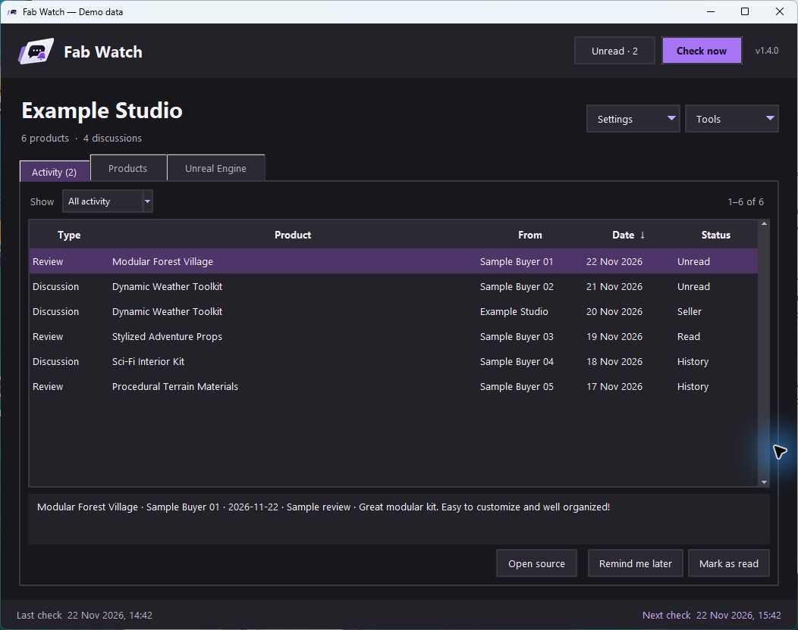
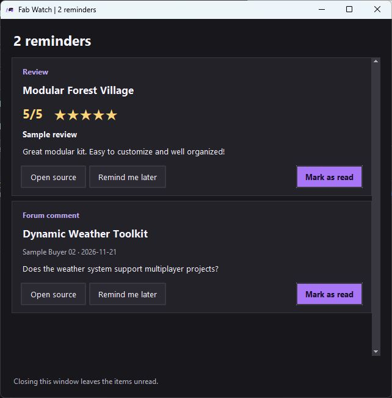

# Fab Watch

Fab Watch checks your Fab listings for new reviews and comments in their linked
Epic forum threads. Paste your seller link once to follow the whole catalog,
including listings you add later. The app can also follow Unreal Engine release
announcements.

[Download for Windows x64](https://github.com/stkopp/fab-watch/releases/latest) ·
[Installation guide](docs/QUICKSTART.md)

**Code provenance:** All Fab Watch application code was generated with AI and
hasn't been reviewed by a person. The [automated tests](tests) are public.

1. Install the Windows setup from Releases.
2. Paste your Fab seller link into **Seller URL** and select **Connect**.
3. Open **Settings → Notifications** to choose your alerts. Try a local test from
   **Tools**.

The first check loads old posts quietly. After that, new reviews and comments
can open a popout or appear in Windows notifications. You can see the score on
each review card, open its source, snooze it, or mark it read. The tray icon
shows when you have unread items. **Check now** runs an immediate seller check.

By default, popouts appear one at a time. Choose **Group in one window** to see
due reminders together.

The **Unreal Engine** tab follows release, preview and hotfix announcements.
Hotfix checks are off by default. To see the check schedule and alert options,
open [Notification settings](docs/NOTIFICATIONS.md).

Fab Watch runs on your PC with your Windows account signed in. It uses public
Fab and Epic forum data and keeps its history locally. It doesn't need a Fab
password or API token. The installer is unsigned. Public sources can change,
and an item deleted between checks may be missed. Fab Watch is independent of
Fab and Epic Games.

[FAQ](docs/FAQ.md) · [Troubleshooting](docs/TROUBLESHOOTING.md) ·
[Updates](docs/UPDATES.md) · [Privacy](docs/PRIVACY.md) ·
[Report a problem](https://github.com/stkopp/fab-watch/issues/new/choose)

## Source and contributions

The [MIT license](LICENSE) permits forks and reuse with the license notice.
See [Contributing](CONTRIBUTING.md) for building and testing, [AGENTS.md](AGENTS.md)
for coding-agent instructions, and [llms.txt](llms.txt) for the project index.
[Third-party notices](THIRD_PARTY.md) cover the bundled runtime. The images use
fictional seller data.
