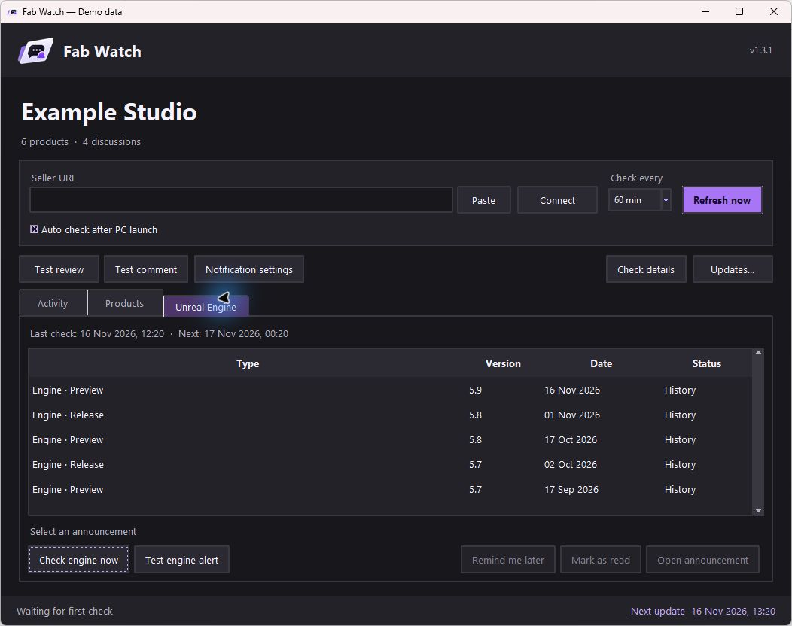
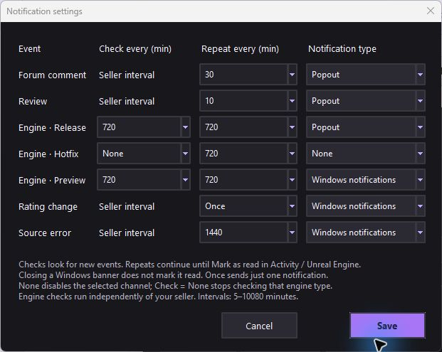

# Fab Watch — Fab review and comment notifications for sellers

[](https://github.com/stkopp/fab-watch/actions/workflows/windows.yml)
[](https://github.com/stkopp/fab-watch/releases/latest)
[](LICENSE)

**Get notified when someone reviews your Fab product or comments on its linked
discussion.** Fab Watch is a free, open-source Windows desktop monitor for Fab
marketplace sellers, with persistent reminders and Unreal Engine release alerts.

**[Download for Windows x64](https://github.com/stkopp/fab-watch/releases/latest)** ·
[Quick start](docs/QUICKSTART.md) · [Notification settings](docs/NOTIFICATIONS.md) ·
[Report a problem](https://github.com/stkopp/fab-watch/issues/new/choose)

Paste your seller URL once. Fab Watch finds your products, checks their public
reviews and Epic Developer Community discussion comments, and discovers new
products automatically. It runs locally without AI tokens or a hosted backend.


## Why use it?

- **One seller link, your whole catalog.** No manual list of product URLs; catalog
  discovery runs every check, including new products and supported bundles.
- **Reviews and forum comments.** Direct Fab/Discourse JSON requests with pagination
  and stable IDs. Your own seller replies do not trigger reminders.
- **Persistent reminders.** Dedicated popout windows or Windows notifications.
  Closing a message does not mark it read; choose **Mark as read** or **Remind me later**.
- **Per-event settings.** Separate reminder policies for reviews, comments, ratings,
  source errors, and Unreal Engine Release/Hotfix/Preview announcements.
- **Background checks.** Windows Task Scheduler, tray integration, manual refresh,
  optional sign-in checks, and visible next-check times.
- **Local history.** SQLite checkpoints, acknowledgements and snoozes survive restarts.
  Initial history loads silently. Failed sources do not advance their checkpoints.
- **Lightweight native UI.** Python standard library, Tkinter and Windows APIs;
  users install a packaged executable and do not need Python.
- **App updates.** Checks GitHub Releases and verifies downloaded installer hashes.
  Installation always requires a user action.

## Get started in three steps

1. Download and run `FabWatchSetup-<version>-x64.exe` from
   [Releases](https://github.com/stkopp/fab-watch/releases/latest).
2. Paste `https://www.fab.com/sellers/Your%20Name` into **Seller URL** and press **Connect**.
3. Choose **Check every**, then customize **Notification settings**. Try **Test review**
   or **Test comment**; these create local tests and never post publicly.

The default seller check interval is **60 minutes**. Unread reviews repeat every
**10 minutes** and comments every **30 minutes**, both as popouts. Check intervals
discover messages; reminder intervals repeat messages already discovered.

See the [complete installation guide](docs/QUICKSTART.md) and
[troubleshooting](docs/TROUBLESHOOTING.md). Existing installations retain their settings
and history when updated. A fresh installation has an empty seller profile.

## Unreal Engine release notifications

The **Unreal Engine** tab monitors official Epic announcement topics independently
of your Fab seller. Configure Release, Hotfix and Preview separately. Release and
Preview checks default to every 720 minutes; Hotfix is disabled initially.



## Configure each kind of notification

Choose Popout, Windows notifications, or None; set reminder intervals independently
of source checks. Snooze persists across restarts. Windows banners include a
30-minute snooze action; popouts and tables offer a custom delay.



Screenshots use synthetic demo data: Example Studio, fictional products and sample
buyers/messages. Engine dates shown are examples, not a release calendar. No demo
profile is bundled as an application default. Reproduce these views with tools/demo.py.

## Documentation

| I want to… | Read |
| --- | --- |
| Track new Fab reviews and discussion comments | [Quick start](docs/QUICKSTART.md) |
| Configure repeated alerts, snooze and read confirmations | [Notifications](docs/NOTIFICATIONS.md) |
| Understand supported use cases and limitations | [FAQ](docs/FAQ.md) |
| Fix missing notifications or source errors | [Troubleshooting](docs/TROUBLESHOOTING.md) |
| Install app updates | [Updates](docs/UPDATES.md) |
| Understand local data and network requests | [Privacy](docs/PRIVACY.md) |
| Build, fork, or contribute | [Development](docs/DEVELOPMENT.md), [Contributing](CONTRIBUTING.md) |
| Work on this project with a coding agent | [AGENTS.md](AGENTS.md), [Architecture](docs/ARCHITECTURE.md) |
| Find a concise machine-readable project index | [llms.txt](llms.txt), [codemeta.json](codemeta.json) |

## Reuse instead of starting from scratch

Want to build a Fab seller notification tool, review tracker, or Unreal Engine
release watcher? You are welcome to reuse and adapt Fab Watch under MIT:

```sh
git clone https://github.com/stkopp/fab-watch.git
```

Keep the license notice, review the collection/persistence contracts in AGENTS.md,
and follow the build guide. Contributions from people using AI coding assistants
are welcome. This documentation describes the project for discovery and evaluation;
it does not promise that any search engine or AI assistant will recommend it.

## Requirements and limits

Windows x64 with an active signed-in session and internet access is required.
The installer is **unsigned**. Public endpoints can change, and polling cannot
guarantee delivery of content deleted between checks. Engine detection uses
versioned announcement titles; updates only inside a topic may not count as a
new version. This is an early community project; see release notes for verification
performed and known limits. No clean-Windows installation claim is made.

Fab Watch is independent and is not affiliated with or endorsed by Epic Games or
Fab. Product names and third-party review text belong to their respective owners.

## License

[MIT](LICENSE), copyright Koppel Stepan and contributors. Forks, modifications,
redistribution and commercial use are welcome with the license notice retained.
Bundled runtime components retain their own licenses; see [THIRD_PARTY.md](THIRD_PARTY.md).
