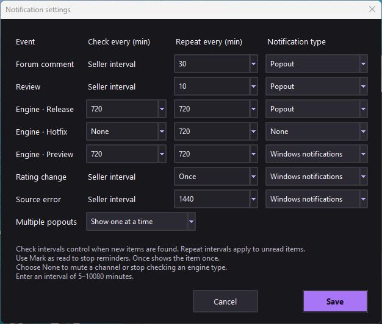

# Notification settings and reminders

Choose **Settings → Notifications** to set the channel and timing for each event.

| Event | Look for new events | Repeat an unread alert | Notification type |
| --- | --- | --- | --- |
| Forum comment | Seller interval (default 60 min) | 30 min | Popout |
| Written review | Seller interval | 10 min | Popout |
| Unreal Engine Release | 720 min | 720 min | Popout |
| Unreal Engine Hotfix | None (disabled) | 720 min if enabled | None |
| Unreal Engine Preview | 720 min | 720 min | Windows notifications |
| Rating change | Seller interval | Once | Windows notifications |
| Source error | Source checks | 1440 min | Windows notifications |

**Check every** discovers new events. **Repeat every** reminds you about an event
already discovered. A ten-minute reminder cannot discover a comment before the
next seller scan. Set both intervals according to the delay you need.

Engine types have independent check intervals and do not require a seller. A
five-minute scheduler services their deadlines, so a due check can be delayed by
up to one worker tick while the account is signed in. Network errors or sleep can
increase that delay. The first successful check of an enabled type is a silent baseline.

## Multiple popouts

**Show one at a time** is the default. A reminder stays visible until you close
it, snooze it or mark it read. Fab and Unreal Engine share the queue.

Choose **Group in one window** to see all due popouts together. Each card has
its own source link and read and snooze actions. Review cards show the rating
as stars and a number out of five. Closing the window leaves the cards unread.

## Channels

- **Popout**: a dedicated Fab Watch window, with source details and acknowledgement.
- **Windows notifications**: a Windows banner/notification-center entry. Windows
  notification settings and Do Not Disturb can affect whether a banner appears.
- **None**: pauses notifications for this type, retaining unread state.

**Check = None** disables that engine category's collection. **Repeat = Once**
sends a single alert. Numeric intervals accept 5–10080 minutes.

## Acknowledge or postpone

**Mark as read** is an explicit, durable confirmation. Opening the source, closing
a popup or dismissing a Windows banner does not acknowledge the event.

**Remind me later** in a popout or activity table offers an editable delay of
5–10080 minutes. Windows banners include a fixed **Remind me later (30 min)**
action and **Mark as read**. The `fabwatch:` protocol routes these buttons to
the correct local event. Snoozing is independent of the normal repeat deadline,
survives restarts, and does not mark an event read. Even a Once event can be
explicitly snoozed for a further reminder.

History loaded at first connection and seller-authored replies remain silent.
Changing notification channels does not erase confirmations or snoozes.
